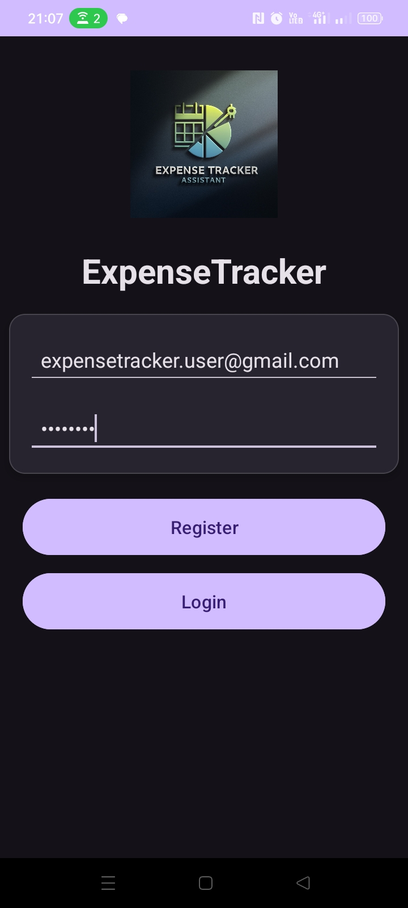
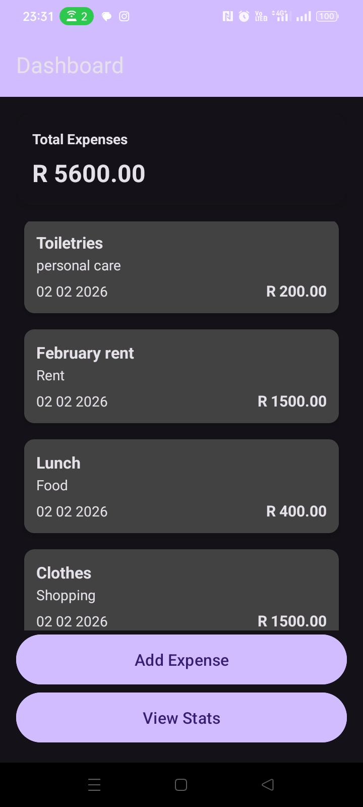
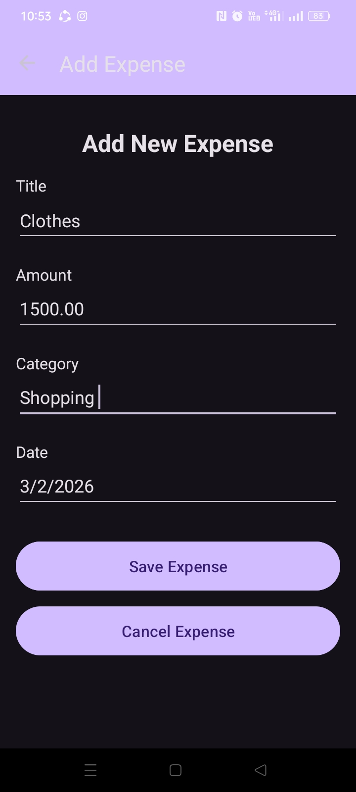
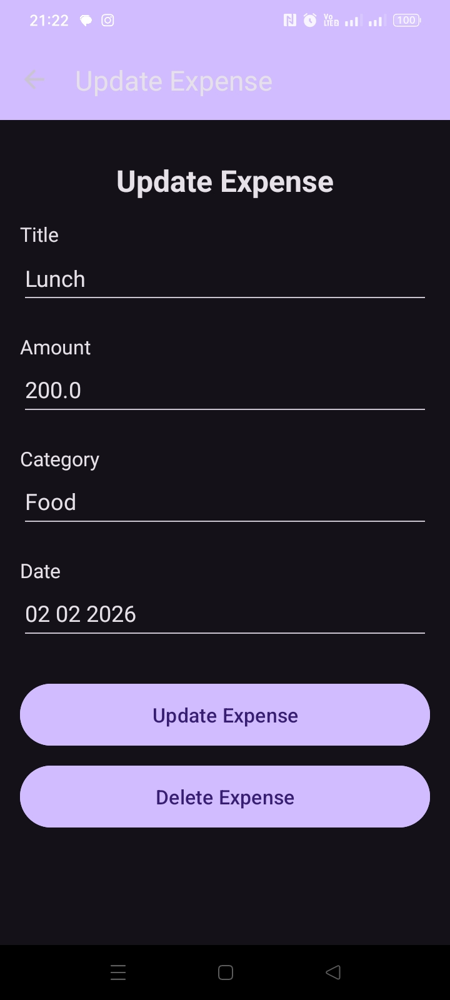
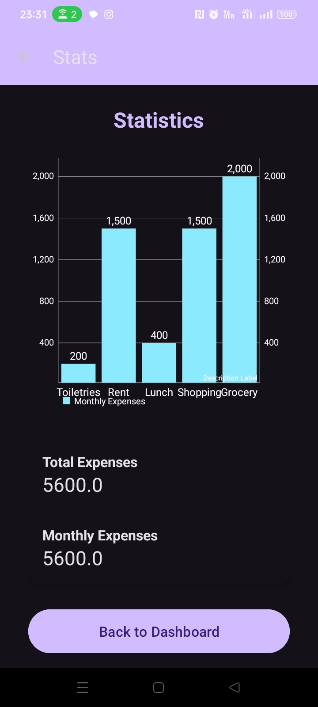

## 📊 Expense Tracker App

## 📌 Overview

Expense Tracker is a **Kotlin Android app** that helps users **track their expenses,** visualize **monthly spending charts,** and manage **personal finance** efficiently. The app supports **dark mode,** integrates with **Firebase Authentication,** and uses **MPAndroidChart** for beautiful charts. 

---

## ✨ Features

- **User Authentication**
   - Register and login with **email & password** via Firebase
- **Expense Management**
   - Add, save, update, cancel, and delete expenses
   - Categories: Food, Rent, Transport, Groceries, Personal care, etc
   - Each expense includes: Title, Amount, Category, and Date
- **Statistics & Charts**
   - Bar Chart showing **monthly expenses per category**
   - Total expenses and monthly totals
   - Automatic dark/light mode support
- **Dark Mode**
   - Follows system theme
   - Material Design 3 colors(colorSurface, colorOnSurface, colorPrimary)
- **Firebase Integration**
   - Authentication and database ready
   - Secure: google-services.json **is ignored in GitHub**

---

## 🛠️ Technologies Used

- Kotlin
- Android SDK
- Firebase Authentication
- MPAndroidChart
- Material Design 3(Dark/Light Theme)

---

## 📱 ScreenShots

#### Login Screen

#### Dashboard Screen

#### Add Expense Screen

#### Update Expense Screen

#### Statistics Screen

---

## 🚀 Installation

1. Clone the repository:
git clone
https://github.com/RapolaiKate/expencetracker.git
2. Open the project in Android Studio
3. Download **Firebase project** and **add** google-services.json to app/folder
4. Let Gradle finish syncing
5. Run the app on an emulator or physical device

---

## 📚 Notes

- google-services.json is **ignored in GitHub** for security.
- The app supports **both light and dark mode** automatically.
- Chart text and axes adapt to theme coors(colorOnSurface) for visibility.

---

## 🔮 Future improvements

- Add **category icons & colors** for better visualization
- Add **filter by month or category**
- Add **export/backup data** feature

---

## 👤 Author
Rapolai Kate
(Android Developer)

---

## 📄 License

This project is for learning and portfolio purposes.

