# 💰 Expense Tracker – Personal Finance Management App

## 📌 Project Overview

Expense Tracker is a Kotlin-based Android application designed to help users manage their personal finances by tracking income and expenses in one place.

The application allows users to record financial transactions, monitor their spending, view income and expense statistics, and track their monthly financial performance through an interactive dashboard.

The app features Firebase Authentication, Room Database for local data storage, and MPAndroidChart for financial data visualization.

## ✨ Key Features

### 🔐 User Authentication
- User registration with email and password.
- Secure login using Firebase Authentication.
- Password visibility controls.
- Logout functionality.

### 💵 Income Management
- Add and save income transactions.
- Edit existing income transactions.
- Delete income transactions.
- Record transaction title, amount, category and date.

### 💳 Expense Management
- Add and save expense transactions.
- Edit existing expense transactions.
- Delete expense transactions.
- Organize expenses by category.
- Record transaction title, amount, category and date.

### 📜 Transaction History
- View income and expense transactions in one place.
- Filter transactions by year, month and transaction type.
- Apply quick filters.
- View transaction details.
- Edit and delete existing transactions.
- Monitor income, expenses and balance.

### 📊 Financial Dashboard
- Monthly financial overview.
- Select different months to review financial performance.
- View total monthly income.
- View total monthly expenses.
- Monitor monthly balance.
- Recent transaction overview.
- Monthly income and expense comparison chart.
- Yearly financial overview.

### 📈 Financial Statistics
- Dedicated Income Statistics screen.
- Dedicated Expense Statistics screen.
- Visual financial data representation using charts.
- Monitor financial activity and spending patterns.

### 🎨 User Interface
- Dark-themed interface.
- Material Design components.
- Organized navigation.
- Financial cards and interactive charts.
- Consistent application styling.

## 🛠️ Technologies & Tools Used

| Technology | Purpose |
|---|---|
| Kotlin | Android application development |
| Android SDK | Android platform development |
| Android Studio | Development environment |
| Firebase Authentication | User authentication |
| Room Database | Local transaction storage |
| SQLite | Local database engine |
| MPAndroidChart | Financial charts and visualization |
| Material Components | UI components and interface design |
| Gradle | Project build and dependency management |

## 📱 Application Screenshots

### 🔐 Authentication

#### 01. Login Screen
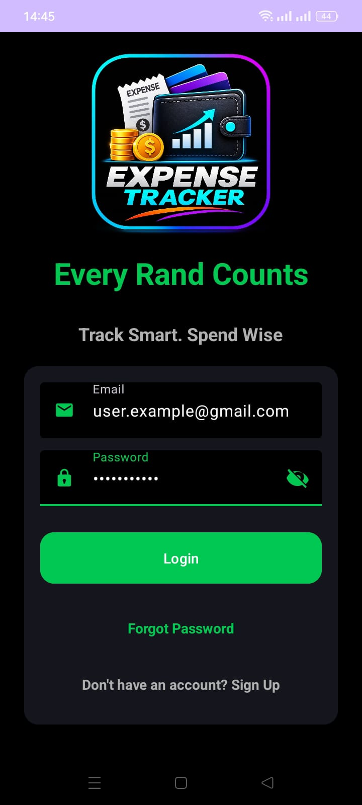

#### 02. Sign Up Screen
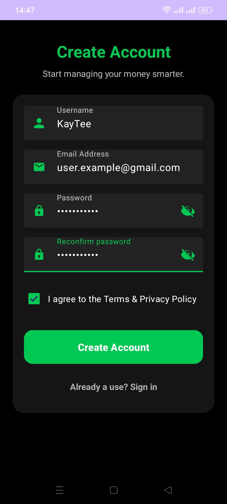

### 🏠 Main Navigation

#### 03. Main Screen
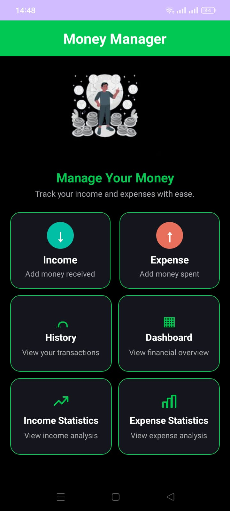

### 💰 Income & Expense Management

#### 04. Add Income
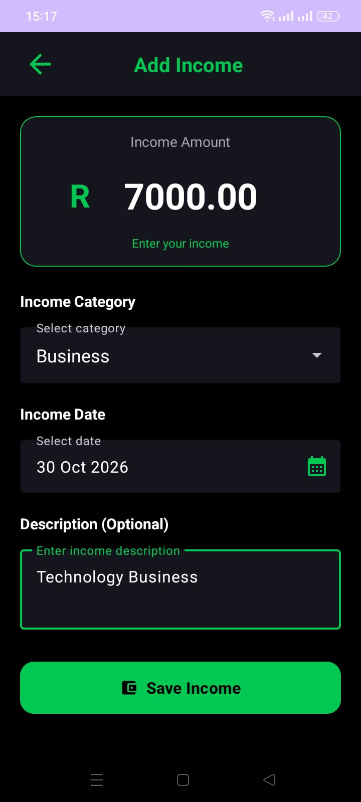

#### 05. Add Expense
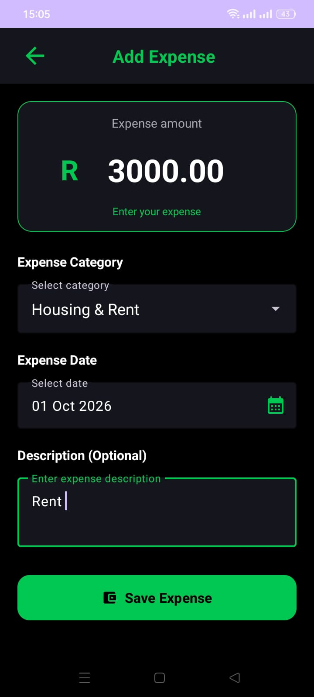

### 📜 Transaction Management

#### 06. Transaction History
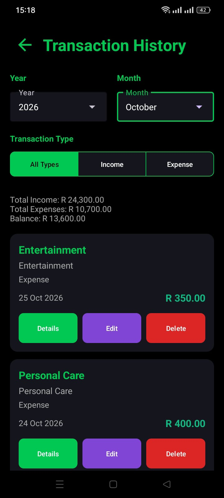

#### 07. Update Transaction
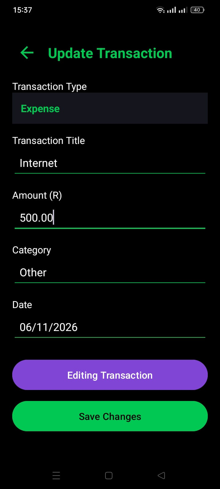

#### 08. Delete Transaction
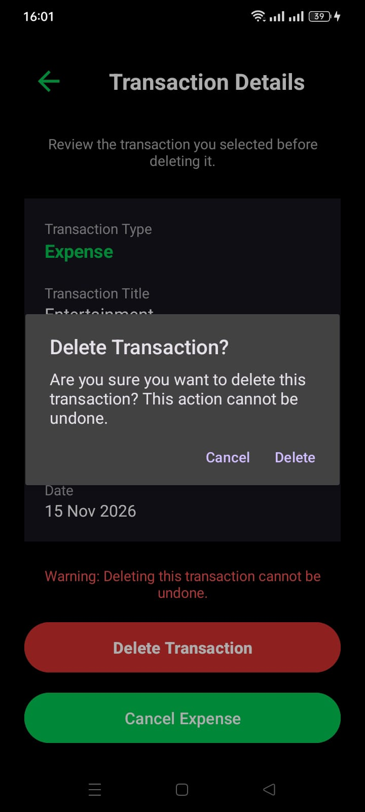

### 📊 Financial Overview

#### 09. Dashboard
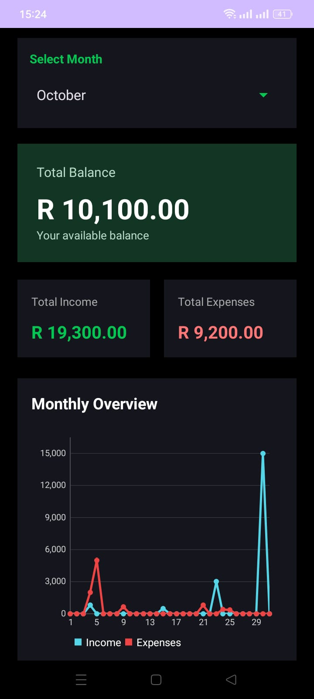

#### 10. Income Statistics
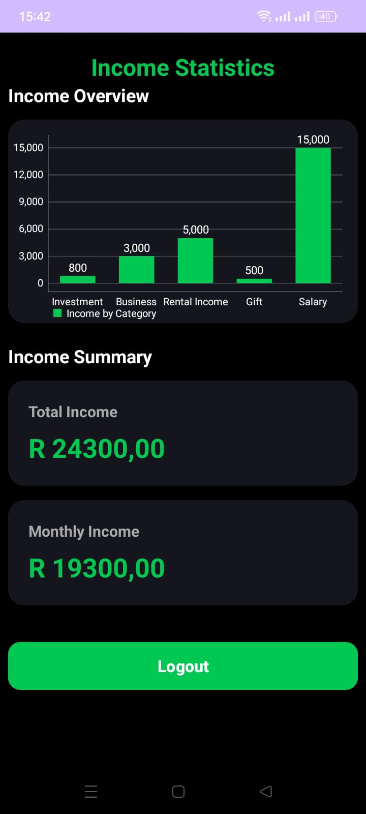

#### 11. Expense Statistics
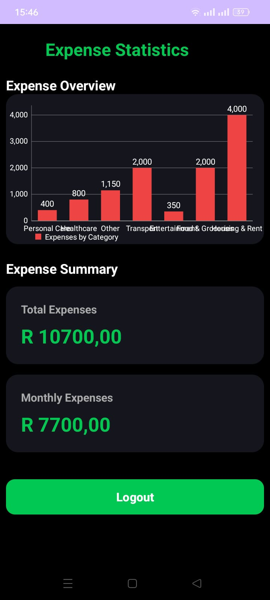


## 🚀 Installation & Setup

### Prerequisites
- Android Studio.
- Android SDK.
- Kotlin support.
- A Firebase project.

### Steps

1. Clone the repository:

   ```bash
   git clone https://github.com/RapolaiKate/expencetracker.git
   ```

2. Open the project in Android Studio.

3. Create or configure your own Firebase project.

4. Enable Firebase Authentication with Email/Password sign-in.

5. Download your Firebase configuration file (`google-services.json`).

6. Place `google-services.json` inside the app directory.

7. Allow Gradle to sync and download the required dependencies.

8. Build and run the application on an Android emulator or physical device.

**Note:** The Firebase configuration file is intentionally excluded from the public GitHub repository. Each developer must configure their own Firebase project.

## 🔒 Security & Data Management

- Firebase Authentication handles user authentication.
- Room Database stores income and expense transactions locally.
- Firebase configuration files are excluded from Git tracking.
- Local configuration and signing credentials should not be committed to the repository.

## 🔮 Future Improvements

- Add transaction category icons and customizable colours.
- Introduce additional financial reports.
- Add transaction export and backup functionality.
- Introduce additional financial insights and budgeting tools.

## 👩‍💻 Author

**Rapolai Kate**

Android Developer | Kotlin Developer

GitHub: [RapolaiKate](https://github.com/RapolaiKate)

## 📄 License

This project is developed for educational, learning and portfolio purposes.
